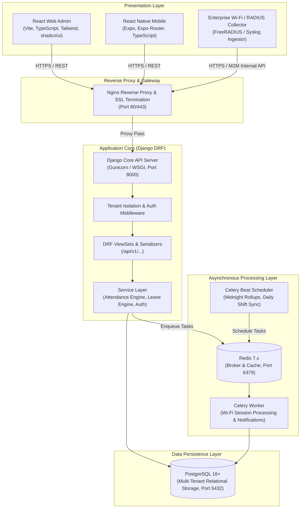
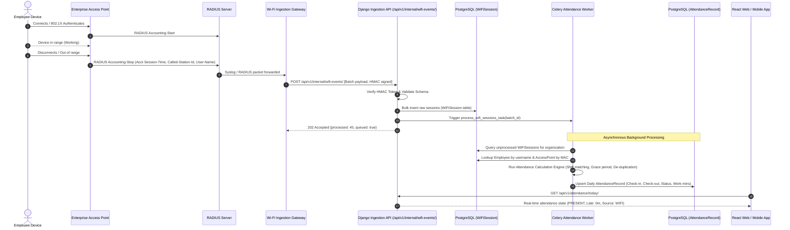
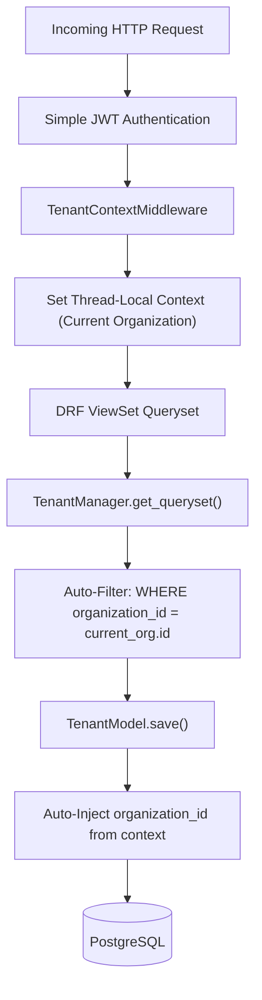
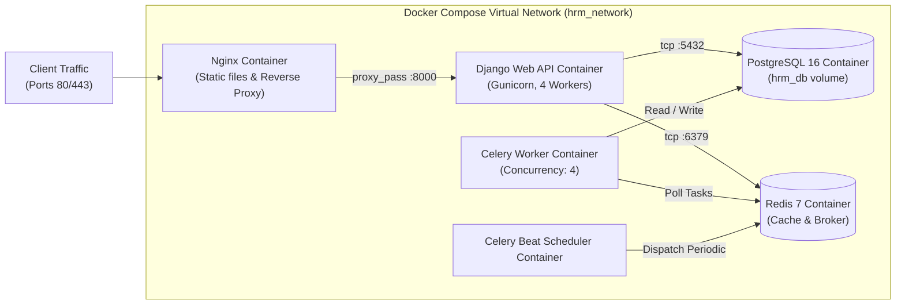

# Enterprise HR Management Platform — System Architecture Specification

**Document Version:** 1.0.0-PROD  
**Target Environment:** Containerized Cloud / On-Premise Enterprise  
**Status:** Approved for Implementation (Phase 1 Baseline)  

---

## 1. High-Level Architecture Overview

The system follows a modern, service-oriented monolithic architecture with asynchronous event processing for heavy network ingestion and scheduled operations.



---

## 2. Monorepo Repository Structure

The project is structured as a unified monorepo for cohesive versioning, cross-platform code sharing, and coordinated deployments:

```
hr-platform/
│
├── apps/
│   ├── web/                          # React Admin Dashboard (Vite, TS, Tailwind, shadcn)
│   │   ├── src/
│   │   │   ├── assets/               # Branding, logos, icons
│   │   │   ├── components/           # UI primitives (shadcn), layouts, shared tables
│   │   │   ├── contexts/             # AuthContext, TenantContext, ThemeContext
│   │   │   ├── hooks/                # TanStack query hooks, debounce, hotkeys
│   │   │   ├── pages/                # Route views (Dashboard, Employees, Attendance, etc.)
│   │   │   ├── services/             # Axios API client, query functions
│   │   │   ├── types/                # TypeScript interfaces matching backend DTOs
│   │   │   └── utils/                # Date formatters, status helpers, validators
│   │   ├── package.json
│   │   ├── tailwind.config.js
│   │   ├── tsconfig.json
│   │   └── vite.config.ts
│   │
│   └── mobile/                       # React Native Mobile App (Expo 52, Expo Router)
│       ├── app/                      # File-based routing (tabs, auth, modals)
│       │   ├── (auth)/               # Login screen
│       │   ├── (tabs)/               # Home, Attendance, Leave, Notifications, Profile
│       │   ├── _layout.tsx           # Root navigation stack
│       │   └── +not-found.tsx
│       ├── components/               # Mobile UI cards, status badges, calendar view
│       ├── hooks/                    # Mobile auth, location, biometric hooks
│       ├── services/                 # Mobile API client, secure storage tokens
│       ├── types/                    # Mobile state and API types
│       ├── app.json                  # Expo configuration
│       ├── package.json
│       └── tsconfig.json
│
├── backend/                          # Django 5 + Django REST Framework Core
│   ├── config/                       # Project configuration
│   │   ├── __init__.py
│   │   ├── asgi.py
│   │   ├── celery.py                 # Celery app initialization
│   │   ├── settings/                 # Modular settings (base, dev, prod)
│   │   ├── urls.py                   # Master routing (/api/v1/)
│   │   └── wsgi.py
│   │
│   ├── apps/                         # Modular domain applications
│   │   ├── accounts/                 # Custom User, Roles, Auth, JWT, Permissions
│   │   ├── organizations/            # Multi-company Tenants, Offices, AccessPoints
│   │   ├── employees/                # Employee profiles, Designations, Emergency contacts
│   │   ├── departments/              # Department hierarchy, Budgets, Heads of Department
│   │   ├── attendance/               # Daily attendance records, punches, corrections
│   │   ├── wifi_attendance/          # RADIUS session ingestion, AP mapping, consolidation
│   │   ├── shifts/                   # Fixed, flexible, rotating shifts, employee shifts
│   │   ├── leaves/                   # Leave types, balances, requests, approval flows
│   │   ├── holidays/                 # Official holidays, calendar exceptions
│   │   ├── notifications/            # In-app notifications, FCM push, email dispatch
│   │   ├── payroll/                  # Basic payroll hooks, work minutes aggregation
│   │   ├── reports/                  # Attendance & leave analytical report generators
│   │   └── audit/                    # Comprehensive, immutable audit logging
│   │
│   ├── tests/                        # Integration and end-to-end test suites
│   ├── manage.py
│   └── requirements.txt
│
├── infrastructure/
│   ├── docker/
│   │   ├── Dockerfile.backend        # Python 3.12 slim Django image
│   │   ├── Dockerfile.web            # Multi-stage Node.js + Nginx web build
│   │   └── Dockerfile.celery         # Celery worker/beat runtime
│   └── nginx/
│       ├── default.conf              # Upstream routing, SSL, gzip, security headers
│       └── mime.types
│
├── docs/                             # Architectural & Operational Documentation
│   ├── product-requirements.md
│   ├── architecture.md
│   ├── database-design.md
│   ├── api-specification.md
│   ├── ui-design.md
│   ├── wifi-attendance-integration.md
│   └── development-roadmap.md
│
├── docker-compose.yml                # Unified development environment orchestration
├── .env.example                      # Documented environment variables template
├── .gitignore                        # Global ignore specification
└── README.md                         # Monorepo setup and onboarding guide
```

---

## 3. Data Flow Architecture

### 3.1 Passive Wi-Fi Attendance Pipeline
The following sequence illustrates how raw Wi-Fi association/disassociation events captured by campus access points are safely converted into official HR attendance records:



---

## 4. Multi-Tenant Isolation Architecture

To guarantee strict multi-tenant isolation, the system uses a **Shared-Database, Discriminator Column Architecture** with triple-layer security enforcement:



### 4.1 Tenancy Enforcement Layers

1. **Layer 1: JWT Claims & Tenant Context Middleware**
   - Access tokens encode `tenant_id` (Organization UUID).
   - `TenantContextMiddleware` extracts and validates the organization, attaching it to `request.tenant` and setting Python thread-safe `contextvars`.

2. **Layer 2: Django ORM Scoping via Custom Base Model**
   ```python
   class TenantBaseModel(models.Model):
       id = models.UUIDField(primary_key=True, default=uuid.uuid4, editable=False)
       organization = models.ForeignKey('organizations.Organization', on_delete=models.CASCADE, related_name="%(class)s_set")
       created_at = models.DateTimeField(auto_now_add=True, db_index=True)
       updated_at = models.DateTimeField(auto_now=True)
       is_deleted = models.BooleanField(default=False, db_index=True)

       objects = TenantManager()
       all_objects = models.Manager()

       class Meta:
           abstract = True
   ```

3. **Layer 3: Scoped Querysets & Object-Level DRF Permissions**
   - Every ViewSet derives from `TenantModelViewSet`, which restricts default queries to `request.tenant`.
   - Object-level permission classes prevent IDOR (Insecure Direct Object Reference) attacks by verifying that target objects belong strictly to the caller's organization.

---

## 5. Security & Authentication Architecture

1. **Authentication Token Lifecycle:**
   - **Access Token:** Lifetime of 15 minutes, payload includes `user_id`, `email`, `role`, `organization_id`.
   - **Refresh Token:** Lifetime of 7 days, stored in HTTP-only secure cookie for web and Encrypted Secure Storage for mobile.
   - **Rotation:** Upon refresh, the previous refresh token is added to the database blacklist (`OutstandingToken` / `BlacklistedToken`), preventing replay attacks.

2. **Internal Ingestion Security:**
   - The Wi-Fi collector communicates with the backend via a dedicated internal API route: `/api/v1/internal/wifi-events/`.
   - Authentication uses a pre-shared cryptographic HMAC secret key passed in the `X-Internal-Secret` header or validated via timestamped HMAC-SHA256 signatures, preventing unauthenticated network injection.

3. **Role-Based Access Control (RBAC):**
   | Role | Organization Scope | Department Scope | Employee Scope | Permissions |
   | :--- | :--- | :--- | :--- | :--- |
   | **SUPER_ADMIN** | Global (Cross-tenant) | All | All | System administration |
   | **HR_ADMIN** | Single Tenant | All | All | Full HR configuration & audit |
   | **MANAGER** | Single Tenant | Assigned Department | Direct & Indirect Reports | Attendance review, leave approval |
   | **EMPLOYEE** | Single Tenant | Assigned Department | Self Only | Profile, punch, leave application |

---

## 6. Docker & Infrastructure Topology



The containerized stack provides health checks, isolated Docker bridges, automated restart policies, and persistent storage volumes for PostgreSQL data and uploaded media files.
