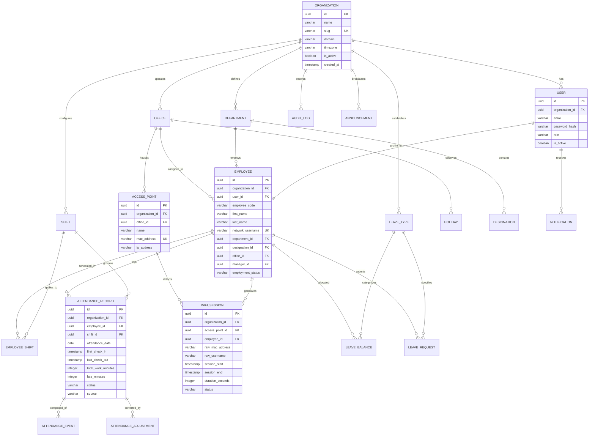

# Enterprise HR Management Platform — Database Design & Schema Specification

**Document Version:** 1.0.0-PROD  
**Database Engine:** PostgreSQL 16+  
**Status:** Approved for Implementation (Phase 1 Baseline)  

---

## 1. Entity-Relationship Overview

The platform uses a relational architecture with strict multi-tenant scoping. Every core model inherits from `TenantBaseModel` to ensure automatic partitioning by `organization_id`.

---

## 2. Table-by-Table Schema Specification

### 2.1 Core Multi-Tenancy & Identity

#### 1. `organizations`
| Column | Type | Constraints | Description |
| :--- | :--- | :--- | :--- |
| `id` | `UUID` | Primary Key, default `gen_random_uuid()` | Unique tenant identifier |
| `name` | `VARCHAR(255)` | NOT NULL | Official company name |
| `slug` | `VARCHAR(100)` | NOT NULL, UNIQUE, Indexed | Subdomain identifier (e.g. `acme-corp`) |
| `domain` | `VARCHAR(255)` | Nullable | Primary email domain for auto-tenant binding |
| `timezone` | `VARCHAR(64)` | NOT NULL, default `'UTC'` | Official IANA timezone (e.g. `'America/New_York'`) |
| `logo_url` | `VARCHAR(512)`| Nullable | Tenant branding asset URL |
| `is_active` | `BOOLEAN` | NOT NULL, default `TRUE` | Tenant operational status |
| `created_at` | `TIMESTAMPTZ`| NOT NULL, default `NOW()` | Tenant provision timestamp |
| `updated_at` | `TIMESTAMPTZ`| NOT NULL, default `NOW()` | Last configuration update |

#### 2. `users`
| Column | Type | Constraints | Description |
| :--- | :--- | :--- | :--- |
| `id` | `UUID` | Primary Key | Unique user identifier |
| `organization_id`| `UUID` | Nullable, FK `organizations(id)` | Tenant binding (null for system superadmin) |
| `email` | `VARCHAR(255)` | NOT NULL | Authentication username |
| `password` | `VARCHAR(255)` | NOT NULL | PBKDF2/Argon2 password hash |
| `role` | `VARCHAR(32)` | NOT NULL | `SUPER_ADMIN`, `HR_ADMIN`, `MANAGER`, `EMPLOYEE` |
| `is_active` | `BOOLEAN` | NOT NULL, default `TRUE` | Account lock/activation status |
| `is_staff` | `BOOLEAN` | NOT NULL, default `FALSE` | Administrative console access |
| `last_login` | `TIMESTAMPTZ`| Nullable | Timestamp of most recent authentication |
| `created_at` | `TIMESTAMPTZ`| NOT NULL, default `NOW()` | Creation timestamp |
| `updated_at` | `TIMESTAMPTZ`| NOT NULL, default `NOW()` | Modification timestamp |

*Constraints:* `UNIQUE(organization_id, email)`.

#### 3. `roles`
| Column | Type | Constraints | Description |
| :--- | :--- | :--- | :--- |
| `id` | `VARCHAR(32)` | Primary Key | Role code (`HR_ADMIN`, `MANAGER`, `EMPLOYEE`) |
| `name` | `VARCHAR(64)` | NOT NULL | Display name |
| `permissions` | `JSONB` | NOT NULL, default `'[]'` | Granular permission capability keys |

---

### 2.2 Organization Structure & Topology

#### 4. `offices`
| Column | Type | Constraints | Description |
| :--- | :--- | :--- | :--- |
| `id` | `UUID` | Primary Key | Unique office identifier |
| `organization_id`| `UUID` | NOT NULL, FK `organizations(id)` | Tenant reference |
| `name` | `VARCHAR(255)` | NOT NULL | Office name (e.g. "HQ Austin", "Branch Tokyo") |
| `address` | `TEXT` | Nullable | Physical street address |
| `latitude` | `DECIMAL(9,6)` | Nullable | GPS latitude coordinate |
| `longitude`| `DECIMAL(9,6)` | Nullable | GPS longitude coordinate |
| `radius_meters` | `INTEGER` | NOT NULL, default `150` | Geofence perimeter in meters |
| `timezone` | `VARCHAR(64)` | NOT NULL | Local office IANA timezone |
| `is_active` | `BOOLEAN` | NOT NULL, default `TRUE` | Active office flag |
| `created_at` | `TIMESTAMPTZ`| NOT NULL, default `NOW()` | Creation timestamp |
| `updated_at` | `TIMESTAMPTZ`| NOT NULL, default `NOW()` | Modification timestamp |

*Indexes:* `INDEX(organization_id, is_active)`.

#### 5. `departments`
| Column | Type | Constraints | Description |
| :--- | :--- | :--- | :--- |
| `id` | `UUID` | Primary Key | Unique department identifier |
| `organization_id`| `UUID` | NOT NULL, FK `organizations(id)` | Tenant reference |
| `name` | `VARCHAR(255)` | NOT NULL | Department title (e.g. "Engineering") |
| `code` | `VARCHAR(50)` | NOT NULL | Department code (e.g. "ENG") |
| `parent_id` | `UUID` | Nullable, FK `departments(id)` | Hierarchical parent department |
| `head_of_department_id`| `UUID` | Nullable, FK `employees(id)` | Assigned department lead |
| `is_deleted` | `BOOLEAN` | NOT NULL, default `FALSE` | Soft deletion flag |
| `created_at` | `TIMESTAMPTZ`| NOT NULL, default `NOW()` | Creation timestamp |
| `updated_at` | `TIMESTAMPTZ`| NOT NULL, default `NOW()` | Modification timestamp |

*Constraints:* `UNIQUE(organization_id, code) WHERE is_deleted = FALSE`.

#### 6. `designations`
| Column | Type | Constraints | Description |
| :--- | :--- | :--- | :--- |
| `id` | `UUID` | Primary Key | Unique designation identifier |
| `organization_id`| `UUID` | NOT NULL, FK `organizations(id)` | Tenant reference |
| `department_id`| `UUID` | NOT NULL, FK `departments(id)` | Parent department |
| `title` | `VARCHAR(255)` | NOT NULL | Job title (e.g. "Senior Backend Engineer") |
| `code` | `VARCHAR(50)` | NOT NULL | Designation code (e.g. "SDE-III") |
| `level` | `INTEGER` | NOT NULL, default `1` | Seniority grade level |
| `is_deleted` | `BOOLEAN` | NOT NULL, default `FALSE` | Soft deletion flag |
| `created_at` | `TIMESTAMPTZ`| NOT NULL, default `NOW()` | Creation timestamp |
| `updated_at` | `TIMESTAMPTZ`| NOT NULL, default `NOW()` | Modification timestamp |

*Constraints:* `UNIQUE(organization_id, department_id, code) WHERE is_deleted = FALSE`.

#### 7. `employees`
| Column | Type | Constraints | Description |
| :--- | :--- | :--- | :--- |
| `id` | `UUID` | Primary Key | Unique employee identifier |
| `organization_id`| `UUID` | NOT NULL, FK `organizations(id)` | Tenant reference |
| `user_id` | `UUID` | NOT NULL, UNIQUE, FK `users(id)` | 1-to-1 User credential linkage |
| `employee_code` | `VARCHAR(50)` | NOT NULL | Company employee badge code |
| `first_name` | `VARCHAR(100)` | NOT NULL | Given name |
| `last_name` | `VARCHAR(100)` | NOT NULL | Family name |
| `work_email` | `VARCHAR(255)` | NOT NULL | Official company email address |
| `phone_number` | `VARCHAR(32)` | Nullable | Primary contact number |
| `gender` | `VARCHAR(16)` | Nullable | Gender identity |
| `date_of_birth` | `DATE` | Nullable | Date of birth |
| `joining_date` | `DATE` | NOT NULL | Date employment commenced |
| `employment_status` | `VARCHAR(32)` | NOT NULL, default `'ACTIVE'` | `ACTIVE`, `PROBATION`, `SUSPENDED`, `TERMINATED` |
| `department_id`| `UUID` | NOT NULL, FK `departments(id)` | Assigned department |
| `designation_id`| `UUID` | NOT NULL, FK `designations(id)` | Assigned designation |
| `office_id` | `UUID` | NOT NULL, FK `offices(id)` | Primary assigned office base |
| `manager_id` | `UUID` | Nullable, FK `employees(id)` | Reporting manager (self-referential) |
| `network_username` | `VARCHAR(128)` | Nullable | Enterprise 802.1X / RADIUS identifier |
| `avatar_url` | `VARCHAR(512)`| Nullable | Profile photo URL |
| `is_deleted` | `BOOLEAN` | NOT NULL, default `FALSE` | Soft deletion flag |
| `created_at` | `TIMESTAMPTZ`| NOT NULL, default `NOW()` | Creation timestamp |
| `updated_at` | `TIMESTAMPTZ`| NOT NULL, default `NOW()` | Modification timestamp |

*Constraints:* `UNIQUE(organization_id, employee_code)`, `UNIQUE(organization_id, network_username) WHERE network_username IS NOT NULL AND is_deleted = FALSE`.  
*Indexes:* `INDEX(organization_id, department_id)`, `INDEX(organization_id, manager_id)`.

---

### 2.3 Shifts & Working Schedules

#### 8. `shifts`
| Column | Type | Constraints | Description |
| :--- | :--- | :--- | :--- |
| `id` | `UUID` | Primary Key | Shift identifier |
| `organization_id`| `UUID` | NOT NULL, FK `organizations(id)` | Tenant reference |
| `name` | `VARCHAR(100)` | NOT NULL | Shift name (e.g. "Standard Day Shift") |
| `code` | `VARCHAR(50)` | NOT NULL | Shift code (e.g. "SH-DAY-09") |
| `shift_type` | `VARCHAR(32)` | NOT NULL, default `'FIXED'` | `FIXED`, `FLEXIBLE`, `ROTATING` |
| `start_time` | `TIME` | NOT NULL | Scheduled shift start |
| `end_time` | `TIME` | NOT NULL | Scheduled shift end |
| `break_duration_minutes` | `INTEGER` | NOT NULL, default `60` | Scheduled lunch/rest break duration |
| `grace_period_minutes` | `INTEGER` | NOT NULL, default `15` | Permissible late arrival window |
| `half_day_threshold_minutes`| `INTEGER` | NOT NULL, default `240` | Minimum minutes for half-day credit |
| `full_day_threshold_minutes`| `INTEGER` | NOT NULL, default `420` | Minimum minutes for full-day credit |
| `is_night_shift`| `BOOLEAN` | NOT NULL, default `FALSE` | Spans midnight (crosses 00:00) |
| `is_deleted` | `BOOLEAN` | NOT NULL, default `FALSE` | Soft deletion flag |
| `created_at` | `TIMESTAMPTZ`| NOT NULL, default `NOW()` | Creation timestamp |
| `updated_at` | `TIMESTAMPTZ`| NOT NULL, default `NOW()` | Modification timestamp |

#### 9. `employee_shifts`
| Column | Type | Constraints | Description |
| :--- | :--- | :--- | :--- |
| `id` | `UUID` | Primary Key | Assignment record ID |
| `organization_id`| `UUID` | NOT NULL, FK `organizations(id)` | Tenant reference |
| `employee_id` | `UUID` | NOT NULL, FK `employees(id)` | Assigned employee |
| `shift_id` | `UUID` | NOT NULL, FK `shifts(id)` | Governing shift rules |
| `start_date` | `DATE` | NOT NULL | Date assignment becomes effective |
| `end_date` | `DATE` | Nullable | Effective end date (null = indefinite) |
| `is_active` | `BOOLEAN` | NOT NULL, default `TRUE` | Current assignment indicator |
| `created_at` | `TIMESTAMPTZ`| NOT NULL, default `NOW()` | Creation timestamp |
| `updated_at` | `TIMESTAMPTZ`| NOT NULL, default `NOW()` | Modification timestamp |

*Indexes:* `INDEX(employee_id, start_date, end_date)`.

#### 10. `holidays`
| Column | Type | Constraints | Description |
| :--- | :--- | :--- | :--- |
| `id` | `UUID` | Primary Key | Holiday record ID |
| `organization_id`| `UUID` | NOT NULL, FK `organizations(id)` | Tenant reference |
| `office_id` | `UUID` | Nullable, FK `offices(id)` | Specific office (null = company-wide) |
| `name` | `VARCHAR(255)` | NOT NULL | Holiday title (e.g. "Independence Day") |
| `holiday_date` | `DATE` | NOT NULL | Date observed |
| `is_recurring` | `BOOLEAN` | NOT NULL, default `FALSE` | Repeats annually |
| `description` | `TEXT` | Nullable | Holiday context |
| `created_at` | `TIMESTAMPTZ`| NOT NULL, default `NOW()` | Creation timestamp |
| `updated_at` | `TIMESTAMPTZ`| NOT NULL, default `NOW()` | Modification timestamp |

*Constraints:* `UNIQUE(organization_id, office_id, holiday_date)`.

---

### 2.4 Wi-Fi Infrastructure & Ingestion Domain

#### 11. `access_points`
| Column | Type | Constraints | Description |
| :--- | :--- | :--- | :--- |
| `id` | `UUID` | Primary Key | Access point identifier |
| `organization_id`| `UUID` | NOT NULL, FK `organizations(id)` | Tenant reference |
| `office_id` | `UUID` | NOT NULL, FK `offices(id)` | Housing office facility |
| `name` | `VARCHAR(255)` | NOT NULL | AP label (e.g. "HQ-Floor3-West-AP04") |
| `mac_address` | `VARCHAR(32)` | NOT NULL | Normalized BSSID / MAC address |
| `ip_address` | `INET` | Nullable | Management IP address |
| `location_description`| `VARCHAR(255)`| Nullable | Floor / room physical landmark |
| `is_active` | `BOOLEAN` | NOT NULL, default `TRUE` | Active tracking state |
| `created_at` | `TIMESTAMPTZ`| NOT NULL, default `NOW()` | Creation timestamp |
| `updated_at` | `TIMESTAMPTZ`| NOT NULL, default `NOW()` | Modification timestamp |

*Constraints:* `UNIQUE(organization_id, mac_address)`.  
*Indexes:* `INDEX(mac_address)`.

#### 12. `wifi_sessions`
| Column | Type | Constraints | Description |
| :--- | :--- | :--- | :--- |
| `id` | `UUID` | Primary Key | Raw session record ID |
| `organization_id`| `UUID` | NOT NULL, FK `organizations(id)` | Tenant reference |
| `access_point_id`| `UUID` | Nullable, FK `access_points(id)`| Matched office AP (null if unknown) |
| `employee_id` | `UUID` | Nullable, FK `employees(id)` | Matched employee (null if unknown) |
| `raw_mac_address`| `VARCHAR(32)`| NOT NULL | Called-Station-Id / AP MAC |
| `raw_username` | `VARCHAR(128)`| NOT NULL | RADIUS User-Name / identity |
| `calling_station_id`| `VARCHAR(32)`| Nullable | Client device MAC (optional/masked) |
| `nas_ip` | `INET` | Nullable | IP address of Network Access Server |
| `session_start` | `TIMESTAMPTZ`| NOT NULL | Connection establishment time |
| `session_end` | `TIMESTAMPTZ`| NOT NULL | Disconnection / session-stop time |
| `duration_seconds`| `INTEGER` | NOT NULL | Net connection duration |
| `status` | `VARCHAR(32)` | NOT NULL, default `'PENDING'` | `PENDING`, `PROCESSED`, `IGNORED`, `ERROR` |
| `error_message` | `TEXT` | Nullable | Error diagnostic if processing failed |
| `created_at` | `TIMESTAMPTZ`| NOT NULL, default `NOW()` | Ingestion timestamp |

*Indexes:* `INDEX(organization_id, status)`, `INDEX(raw_username, session_start)`, `INDEX(raw_mac_address)`.

---

### 2.5 Attendance Domain

#### 13. `attendance_records`
| Column | Type | Constraints | Description |
| :--- | :--- | :--- | :--- |
| `id` | `UUID` | Primary Key | Consolidated daily attendance ID |
| `organization_id`| `UUID` | NOT NULL, FK `organizations(id)` | Tenant reference |
| `employee_id` | `UUID` | NOT NULL, FK `employees(id)` | Target employee |
| `shift_id` | `UUID` | Nullable, FK `shifts(id)` | Applicable shift on date |
| `attendance_date`| `DATE` | NOT NULL | Official calendar date |
| `first_check_in` | `TIMESTAMPTZ`| Nullable | Earliest arrival / connection time |
| `last_check_out` | `TIMESTAMPTZ`| Nullable | Latest departure / disconnection time |
| `total_work_minutes`| `INTEGER` | NOT NULL, default `0` | Net active in-office / work minutes |
| `late_minutes` | `INTEGER` | NOT NULL, default `0` | Minutes arrived after grace cutoff |
| `early_departure_minutes`| `INTEGER`| NOT NULL, default `0` | Minutes departed prior to shift end |
| `overtime_minutes`| `INTEGER` | NOT NULL, default `0` | Approved extra work duration |
| `status` | `VARCHAR(32)` | NOT NULL, default `'ABSENT'` | `PRESENT`, `LATE`, `HALF_DAY`, `ABSENT`, `ON_LEAVE`, `HOLIDAY`, `WEEKEND` |
| `source` | `VARCHAR(32)` | NOT NULL, default `'WIFI'` | `WIFI`, `MANUAL`, `ADMIN_CORRECTION` |
| `is_finalized` | `BOOLEAN` | NOT NULL, default `FALSE` | Locked against automatic recalc |
| `notes` | `TEXT` | Nullable | Operational or administrative remarks |
| `created_at` | `TIMESTAMPTZ`| NOT NULL, default `NOW()` | Record generation timestamp |
| `updated_at` | `TIMESTAMPTZ`| NOT NULL, default `NOW()` | Last recalculation timestamp |

*Constraints:* `UNIQUE(organization_id, employee_id, attendance_date)`.  
*Indexes:* `INDEX(organization_id, attendance_date, status)`, `INDEX(employee_id, attendance_date)`.

#### 14. `attendance_events`
| Column | Type | Constraints | Description |
| :--- | :--- | :--- | :--- |
| `id` | `UUID` | Primary Key | Granular punch event identifier |
| `organization_id`| `UUID` | NOT NULL, FK `organizations(id)` | Tenant reference |
| `attendance_record_id`| `UUID`| NOT NULL, FK `attendance_records(id)`| Parent daily record |
| `employee_id` | `UUID` | NOT NULL, FK `employees(id)` | Acting employee |
| `event_type` | `VARCHAR(32)` | NOT NULL | `CHECK_IN`, `CHECK_OUT`, `WIFI_CONNECT`, `WIFI_DISCONNECT` |
| `timestamp` | `TIMESTAMPTZ`| NOT NULL | Precise occurrence timestamp |
| `source` | `VARCHAR(32)` | NOT NULL | `WIFI`, `MOBILE_APP`, `WEB_PORTAL`, `ADMIN` |
| `latitude` | `DECIMAL(9,6)` | Nullable | Geolocation at punch time |
| `longitude`| `DECIMAL(9,6)` | Nullable | Geolocation at punch time |
| `access_point_id`| `UUID` | Nullable, FK `access_points(id)`| Associated AP for Wi-Fi events |
| `metadata` | `JSONB` | NOT NULL, default `'{}'` | Device model, IP, BSSID details |
| `created_at` | `TIMESTAMPTZ`| NOT NULL, default `NOW()` | Event logging timestamp |

#### 15. `attendance_adjustments`
| Column | Type | Constraints | Description |
| :--- | :--- | :--- | :--- |
| `id` | `UUID` | Primary Key | Adjustment ticket ID |
| `organization_id`| `UUID` | NOT NULL, FK `organizations(id)` | Tenant reference |
| `attendance_record_id`| `UUID`| NOT NULL, FK `attendance_records(id)`| Target attendance record |
| `requested_by_id`| `UUID`| NOT NULL, FK `employees(id)` | Employee or manager requesting |
| `reviewed_by_id`| `UUID` | Nullable, FK `users(id)` | HR Admin / Manager reviewer |
| `original_status`| `VARCHAR(32)`| NOT NULL | Status prior to correction |
| `requested_status`| `VARCHAR(32)`| NOT NULL | Proposed status |
| `original_check_in`| `TIMESTAMPTZ`| Nullable | Original check-in timestamp |
| `requested_check_in`| `TIMESTAMPTZ`| Nullable | Corrected check-in timestamp |
| `original_check_out`| `TIMESTAMPTZ`| Nullable | Original check-out timestamp |
| `requested_check_out`| `TIMESTAMPTZ`| Nullable | Corrected check-out timestamp |
| `reason` | `TEXT` | NOT NULL | Mandatory explanation for audit |
| `review_status` | `VARCHAR(32)` | NOT NULL, default `'PENDING'` | `PENDING`, `APPROVED`, `REJECTED` |
| `review_notes` | `TEXT` | Nullable | Decision justification |
| `reviewed_at` | `TIMESTAMPTZ`| Nullable | Review decision timestamp |
| `created_at` | `TIMESTAMPTZ`| NOT NULL, default `NOW()` | Submission timestamp |
| `updated_at` | `TIMESTAMPTZ`| NOT NULL, default `NOW()` | Update timestamp |

---

### 2.6 Leave Management Domain

#### 16. `leave_types`
| Column | Type | Constraints | Description |
| :--- | :--- | :--- | :--- |
| `id` | `UUID` | Primary Key | Leave category identifier |
| `organization_id`| `UUID` | NOT NULL, FK `organizations(id)` | Tenant reference |
| `name` | `VARCHAR(100)` | NOT NULL | Leave name (e.g. "Annual Leave") |
| `code` | `VARCHAR(50)` | NOT NULL | Policy code (e.g. "ANNUAL", "SICK") |
| `default_quota_days`| `DECIMAL(4,1)`| NOT NULL, default `0.0` | Default annual allocation in days |
| `is_paid` | `BOOLEAN` | NOT NULL, default `TRUE` | Paid vs unpaid leave category |
| `requires_attachment`| `BOOLEAN`| NOT NULL, default `FALSE`| Requires medical certificate, etc. |
| `max_carryover_days`| `DECIMAL(4,1)`| NOT NULL, default `0.0`| Max days rolled over into new year |
| `is_deleted` | `BOOLEAN` | NOT NULL, default `FALSE` | Soft deletion flag |
| `created_at` | `TIMESTAMPTZ`| NOT NULL, default `NOW()` | Creation timestamp |
| `updated_at` | `TIMESTAMPTZ`| NOT NULL, default `NOW()` | Modification timestamp |

*Constraints:* `UNIQUE(organization_id, code) WHERE is_deleted = FALSE`.

#### 17. `leave_balances`
| Column | Type | Constraints | Description |
| :--- | :--- | :--- | :--- |
| `id` | `UUID` | Primary Key | Balance ledger ID |
| `organization_id`| `UUID` | NOT NULL, FK `organizations(id)` | Tenant reference |
| `employee_id` | `UUID` | NOT NULL, FK `employees(id)` | Target employee |
| `leave_type_id` | `UUID` | NOT NULL, FK `leave_types(id)` | Applicable leave category |
| `year` | `INTEGER` | NOT NULL | Accrual fiscal year (e.g. 2026) |
| `allocated_days` | `DECIMAL(4,1)`| NOT NULL, default `0.0` | Total days credited for the year |
| `used_days` | `DECIMAL(4,1)`| NOT NULL, default `0.0` | Approved leave days consumed |
| `pending_days` | `DECIMAL(4,1)`| NOT NULL, default `0.0` | Days tied up in pending requests |
| `remaining_days`| `DECIMAL(4,1)`| NOT NULL, default `0.0` | Currently available balance |
| `created_at` | `TIMESTAMPTZ`| NOT NULL, default `NOW()` | Ledger creation timestamp |
| `updated_at` | `TIMESTAMPTZ`| NOT NULL, default `NOW()` | Balance update timestamp |

*Constraints:* `UNIQUE(organization_id, employee_id, leave_type_id, year)`.

#### 18. `leave_requests`
| Column | Type | Constraints | Description |
| :--- | :--- | :--- | :--- |
| `id` | `UUID` | Primary Key | Leave application identifier |
| `organization_id`| `UUID` | NOT NULL, FK `organizations(id)` | Tenant reference |
| `employee_id` | `UUID` | NOT NULL, FK `employees(id)` | Requesting employee |
| `leave_type_id` | `UUID` | NOT NULL, FK `leave_types(id)` | Requested category |
| `start_date` | `DATE` | NOT NULL | Leave start date |
| `end_date` | `DATE` | NOT NULL | Leave end date (inclusive) |
| `total_days` | `DECIMAL(4,1)`| NOT NULL | Calculated work days duration |
| `reason` | `TEXT` | NOT NULL | Justification for leave |
| `attachment_url`| `VARCHAR(512)`| Nullable | Uploaded documentation URL |
| `status` | `VARCHAR(32)` | NOT NULL, default `'PENDING'` | `PENDING`, `APPROVED`, `REJECTED`, `CANCELLED` |
| `reviewed_by_id`| `UUID` | Nullable, FK `users(id)` | Decision author |
| `review_notes` | `TEXT` | Nullable | Approval or rejection commentary |
| `reviewed_at` | `TIMESTAMPTZ`| Nullable | Timestamp of approval/rejection |
| `created_at` | `TIMESTAMPTZ`| NOT NULL, default `NOW()` | Application submission timestamp |
| `updated_at` | `TIMESTAMPTZ`| NOT NULL, default `NOW()` | State change timestamp |

*Indexes:* `INDEX(organization_id, status)`, `INDEX(employee_id, start_date)`.

---

### 2.7 Communications & Governance

#### 19. `notifications`
| Column | Type | Constraints | Description |
| :--- | :--- | :--- | :--- |
| `id` | `UUID` | Primary Key | Notification identifier |
| `organization_id`| `UUID` | NOT NULL, FK `organizations(id)` | Tenant reference |
| `recipient_id` | `UUID` | NOT NULL, FK `users(id)` | Target recipient account |
| `title` | `VARCHAR(255)` | NOT NULL | Short notification headline |
| `message` | `TEXT` | NOT NULL | Full notification body |
| `notification_type`| `VARCHAR(32)`| NOT NULL | `ATTENDANCE`, `LEAVE`, `ANNOUNCEMENT`, `SYSTEM` |
| `is_read` | `BOOLEAN` | NOT NULL, default `FALSE` | Read acknowledgement |
| `action_url` | `VARCHAR(255)` | Nullable | Deep link / navigation target |
| `created_at` | `TIMESTAMPTZ`| NOT NULL, default `NOW()` | Dispatch timestamp |

*Indexes:* `INDEX(recipient_id, is_read, created_at)`.

#### 20. `announcements`
| Column | Type | Constraints | Description |
| :--- | :--- | :--- | :--- |
| `id` | `UUID` | Primary Key | Announcement identifier |
| `organization_id`| `UUID` | NOT NULL, FK `organizations(id)` | Tenant reference |
| `title` | `VARCHAR(255)` | NOT NULL | Headline |
| `content` | `TEXT` | NOT NULL | Markdown / Rich-text content |
| `published_by_id`| `UUID`| NOT NULL, FK `users(id)` | Author account |
| `target_department_id`| `UUID`| Nullable, FK `departments(id)`| Targeted dept (null = company-wide) |
| `is_pinned` | `BOOLEAN` | NOT NULL, default `FALSE` | Pinned to top of dashboard |
| `publish_date` | `TIMESTAMPTZ`| NOT NULL, default `NOW()` | Visibility start timestamp |
| `expires_at` | `TIMESTAMPTZ`| Nullable | Automatic archival timestamp |
| `created_at` | `TIMESTAMPTZ`| NOT NULL, default `NOW()` | Creation timestamp |
| `updated_at` | `TIMESTAMPTZ`| NOT NULL, default `NOW()` | Update timestamp |

#### 21. `audit_logs`
| Column | Type | Constraints | Description |
| :--- | :--- | :--- | :--- |
| `id` | `UUID` | Primary Key | Immutable audit record ID |
| `organization_id`| `UUID` | NOT NULL, FK `organizations(id)` | Tenant reference |
| `user_id` | `UUID` | Nullable, FK `users(id)` | Actor account (null for background jobs) |
| `action` | `VARCHAR(32)` | NOT NULL | `CREATE`, `UPDATE`, `DELETE`, `ADJUST`, `AUTH` |
| `entity_name` | `VARCHAR(64)` | NOT NULL | Target table/model (e.g. `'AttendanceRecord'`) |
| `entity_id` | `VARCHAR(64)` | NOT NULL | Primary key of modified entity |
| `ip_address` | `INET` | Nullable | Origin IP address |
| `user_agent` | `TEXT` | Nullable | Client user agent string |
| `diff` | `JSONB` | NOT NULL, default `'{}'` | Snapshot of modified fields `{before: {}, after: {}}` |
| `created_at` | `TIMESTAMPTZ`| NOT NULL, default `NOW()` | Event timestamp |

*Indexes:* `INDEX(organization_id, entity_name, entity_id)`, `INDEX(created_at)`.
