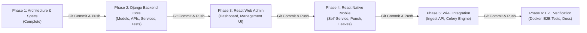

# Enterprise HR Management Platform — Development Roadmap & Implementation Plan

**Document Version:** 1.0.0-PROD  
**Target Completion:** Production Baseline Across All 6 Phases  
**Git Requirement:** Verified Git commit and push to remote after every phase  
**Status:** Approved for Implementation (Phase 1 Baseline)  

---

## 1. Master Phase Overview & Progression Gates

The project is structured into six discrete, verifiable phases. In accordance with the mandatory Git workflow, each phase requires automated testing, security validation, code review, a descriptive commit, and a verified push to the configured remote repository before progressing to the subsequent phase.

---

## 2. Phase-by-Phase Detailed Breakdown

### Phase 1: Architecture, System Design & Technical Specifications (Current)
* **Goal:** Establish foundational engineering documents, ERD diagrams, API schemas, UI design guidelines, Wi-Fi integration blueprint, and workspace structure.
* **Deliverables:**
  - `docs/product-requirements.md` (Functional & non-functional requirements, personas, SLAs)
  - `docs/architecture.md` (System topology, monorepo structure, data flows, security)
  - `docs/database-design.md` (PostgreSQL ERD, 21 models, indexes, tenant isolation)
  - `docs/api-specification.md` (OpenAPI/REST schemas, endpoints, request/response DTOs)
  - `docs/ui-design.md` (Design tokens, web admin screens, mobile Expo Router flows)
  - `docs/wifi-attendance-integration.md` (Deep analysis of reference repo, enterprise adaptation)
  - `docs/development-roadmap.md` (Milestones, gating criteria, verification procedures)
* **Validation & Gating Criteria:**
  - All 7 technical documents authored and verified.
  - Git remote connectivity verified (`git@github.com:a2adib/HRMApp.git`).
  - Strict `.gitignore` updated to ensure no secrets, virtual environments, or build artifacts are tracked.
* **Commit Message:** `docs: add HR platform architecture and implementation plan`

---

### Phase 2: Django Backend & Core Domain Services
* **Goal:** Implement the production Django 5 / DRF backend inside `backend/` with PostgreSQL multi-tenancy, JWT authentication, and service-layer business logic.
* **Deliverables:**
  - Modular Django Apps:
    - `apps/organizations`: Multi-tenant Organization, Office, AccessPoint models and views.
    - `apps/accounts`: Custom User model, JWT token rotation, RBAC permissions.
    - `apps/employees`: Employee profiles, designations, managers, employee directory.
    - `apps/departments`: Department hierarchy and organizational chart.
    - `apps/shifts`: Fixed, flexible, rotational shifts and employee shift scheduling.
    - `apps/attendance`: Attendance records, manual punches, adjustments, attendance calculator service.
    - `apps/leaves`: Leave types, annual balances, leave requests, approval service.
    - `apps/holidays`: Company and office holiday calendars.
    - `apps/notifications`: In-app notification dispatcher and read receipts.
    - `apps/reports`: Aggregated attendance and leave analytics generators.
    - `apps/audit`: Immutable audit logging signals and diff tracker.
  - Multi-tenant query scoping middleware and base model classes.
  - Seed Data Command: Comprehensive development fixtures (`seed_data.py`) with realistic companies, departments, shifts, employees, attendance history, and leaves.
  - Automated Pytest Suite: Unit tests, API integration tests, tenant isolation tests, and attendance calculation unit tests.
* **Validation & Gating Criteria:**
  - All migrations apply cleanly on PostgreSQL / SQLite.
  - 100% test pass rate with zero deprecation warnings.
  - Seed command executes idempotently.
* **Commit Message:** `feat(backend): implement Django HR backend and APIs`

---

### Phase 3: React Web Admin Dashboard
* **Goal:** Build the React + TypeScript web application for HR Administrators and Managers inside `apps/web/`.
* **Deliverables:**
  - Modern UI Shell: Collapsible sidebar, breadcrumbs, search (`⌘K`), notifications, user menu.
  - 19 Screen Views:
    1. Login & Password Reset
    2. HR Executive Dashboard (Metrics cards, Recharts attendance trends, department breakdowns)
    3. Employee Directory (Data tables with pagination, multi-attribute filter, column sorting)
    4. Employee Profile & History
    5. Create Employee Form (React Hook Form + Zod validation)
    6. Edit Employee Drawer
    7. Daily Attendance Overview (Real-time presence roster, source tags)
    8. Attendance Details & Time Logs
    9. Attendance Corrections Approval Queue
    10. Leave Management Overview
    11. Leave Request Approval Drawer
    12. Departments & Organizational Tree
    13. Shifts & Working Schedules
    14. Company Holidays Calendar
    15. Analytics & Exportable Reports (CSV/JSON)
    16. Wi-Fi Access Points & Ingestion Monitor
    17. Notifications Center
    18. Organization Profile & Preferences
    19. User Role Management & Audit Log Explorer
  - API Client Layer: Axios instance with automatic JWT token refresh interceptor.
  - State Management: TanStack Query v5 with optimistic UI updates and cache invalidation.
* **Validation & Gating Criteria:**
  - TypeScript compilation passes with zero type errors (`npm run build`).
  - Responsive layouts render properly across desktop and tablet viewports.
* **Commit Message:** `feat(web): implement HR admin dashboard`

---

### Phase 4: React Native Employee Mobile Application
* **Goal:** Build the touch-first React Native Expo application for iOS and Android inside `apps/mobile/`.
* **Deliverables:**
  - Expo Router Tab Navigation:
    - `Home Tab`: Greeting, hero punch card, live work timer, Wi-Fi status indicator, quick actions.
    - `Attendance Tab`: Monthly attendance calendar, daily punch details, correction request modal.
    - `Leave Tab`: Categorized leave balances (Annual, Sick, Casual), leave application form, history.
    - `Notifications Tab`: Push alerts for approved leaves, announcements, shift changes.
    - `Profile Tab`: Employee credentials, assigned shift details, biometric auth toggle, sign out.
  - Authentication: Secure token storage via `expo-secure-store` with automatic token refresh.
  - Tactile Punch Experience: Haptic feedback, location verification, and instant status reflection.
* **Validation & Gating Criteria:**
  - TypeScript type checking passes cleanly.
  - Expo development server starts without warnings.
  - Works smoothly across iOS and Android simulations.
* **Commit Message:** `feat(mobile): implement employee mobile application`

---

### Phase 5: Wi-Fi Attendance Integration & Processing Pipeline
* **Goal:** Implement the asynchronous Wi-Fi ingestion API, session deduplication engine, and Celery background workers.
* **Deliverables:**
  - Internal Ingestion API: `POST /api/v1/internal/wifi-events/` with HMAC authentication.
  - Wi-Fi Session Processor Service:
    - Match RADIUS `User-Name` against `Employee.network_username`.
    - Match `Called-Station-Id` against registered `AccessPoint` records.
    - Flapping filter: Merges micro-disconnects (< 5 minutes).
    - Multi-session consolidation: Aggregates daily sessions into unified `AttendanceRecord`.
    - Shift evaluator: Computes late minutes, early departures, and net work minutes.
  - Celery Tasks:
    - `process_wifi_sessions_batch`: Asynchronous session batch processor.
    - `reconcile_missing_checkouts`: Nightly Celery Beat task to close unterminated sessions.
  - Synthetic Event Feeder CLI: `scripts/mock_wifi_feeder.py` to stream realistic RADIUS traffic during local testing.
* **Validation & Gating Criteria:**
  - Ingestion endpoint handles 1,000+ synthetic events without latency spikes.
  - Attendance records calculate accurately with verified late and work duration metrics.
* **Commit Message:** `feat(attendance): integrate Wi-Fi attendance processing`

---

### Phase 6: E2E Verification, Docker Infrastructure & Final Documentation
* **Goal:** Assemble the unified Docker Compose environment, run end-to-end integration tests, and finalize operations documentation.
* **Deliverables:**
  - `docker-compose.yml` orchestrating:
    - PostgreSQL 16
    - Redis 7
    - Django Backend API
    - Celery Worker & Celery Beat
    - React Web Admin
    - Nginx Gateway
  - Health checks, database initialization scripts, and seed migrations.
  - Full test suite execution across backend, web, and mobile.
  - Comprehensive `README.md` with step-by-step developer onboarding instructions.
* **Validation & Gating Criteria:**
  - `docker-compose up` boots all services with green health checks.
  - Zero critical bugs or security flaws.
* **Commit Message:** `test: finalize HR platform testing and documentation`

---

## 3. Workspace Transition Strategy

The current workspace contains prototype directories (`hrm_backend`, `hrm_frontend`, `hrm_mobile`). The following transition plan preserves prior assets while aligning with the required monorepo architecture:

1. **Preservation:** Existing files and git history are completely preserved.
2. **Directory Alignment:**
   - Production Django backend structured under `backend/`.
   - Production React admin dashboard structured under `apps/web/`.
   - Production React Native mobile application structured under `apps/mobile/`.
   - Docker and reverse proxy assets organized under `infrastructure/`.
3. **Clean Boundaries:** Legacy prototype code will be safely referenced or migrated into the new modular architecture during Phase 2, 3, and 4 without destructive overwrites.
