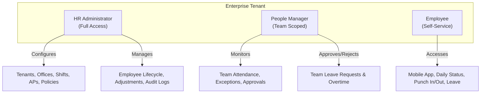

# Enterprise HR Management Platform — Product Requirements Document (PRD)

**Document Version:** 1.0.0-PROD  
**Target Architecture:** Multi-Tenant Enterprise HR Platform  
**Authors:** Senior Software Architect & Product Lead  
**Status:** Approved for Implementation (Phase 1 Baseline)  

---

## 1. Executive Summary & Vision

The Enterprise Human Resource Management (HRM) Platform is a multi-tenant, cloud-native HR automation system built for modern distributed enterprises. It solves the friction of traditional attendance logging, manual leave approvals, and rigid shift tracking by uniting:

1. **A Web Admin Dashboard (React + TypeScript + Tailwind + shadcn/ui)** for HR Administrators and People Managers.
2. **A Native Employee Mobile App (React Native + Expo)** for iOS and Android self-service.
3. **A Robust Backend Core (Python + Django + Django REST Framework + PostgreSQL)** providing transactional integrity, role-based access control, and strict tenant isolation.
4. **An Asynchronous Wi-Fi & RADIUS Attendance Integration Pipeline** leveraging existing enterprise access points (802.1X / RADIUS accounting) to passively infer presence without battery-draining continuous background GPS or mobile BLE scanning.

---

## 2. Target Personas & User Roles

The platform enforces three distinct user roles governed by Role-Based Access Control (RBAC):

### 2.1 Persona 1: Employee
* **Primary Interface:** React Native Mobile Application (iOS & Android).
* **Core Objectives:**
  - View daily shift timing, office location, and real-time attendance status.
  - Execute explicit check-in/check-out punches when outside office Wi-Fi range (with geofence/source tracking).
  - Verify passive Wi-Fi attendance sessions registered during office hours.
  - Inspect monthly attendance calendar (present, late, absent, on-leave, holiday).
  - Check real-time leave balances across categorized leave types (Annual, Sick, Casual, Unpaid).
  - Submit leave requests with reason and attachments; track approval workflows.
  - Review company announcements and upcoming organization holidays.
  - Manage personal profile settings and security credentials.

### 2.2 Persona 2: People Manager
* **Primary Interface:** Web Admin Dashboard (Team Management View) & Mobile App.
* **Core Objectives:**
  - Monitor live team presence: who is in office, working remotely, late, absent, or on leave.
  - Receive actionable notifications for pending leave requests and attendance adjustments.
  - Review and approve/reject leave requests with contextual team calendar overlap checks.
  - Inspect attendance exceptions (late arrivals, missing check-outs, zero-session anomalies).
  - Export team attendance summaries and punctuality trends.

### 2.3 Persona 3: HR Administrator
* **Primary Interface:** Web Admin Dashboard (Full Management Suite).
* **Core Objectives:**
  - Configure multi-office topology, geographical parameters, and enterprise Wi-Fi Access Points (SSID, BSSID, NAS-IP).
  - Maintain organization hierarchy (Departments, Designations, Job Levels, Shifts).
  - Manage complete employee lifecycles: onboarding, invitations, credential provisioning, department assignment, role delegation, offboarding/deactivation.
  - Establish organization shift schedules (flexible, fixed, rotating), grace periods, break intervals, and overtime thresholds.
  - Govern leave policies: leave types, annual quotas, accrual intervals, carry-over limits, and approval chains.
  - Perform manual attendance adjustments with mandatory audit reason logging.
  - Audit all critical administrative operations via comprehensive, immutable audit logs.
  - Monitor internal Wi-Fi ingestion pipeline health and replay failed raw session batches.

---

## 3. Multi-Tenant Architecture & Enterprise Isolation

The platform is designed as a **Row-Level Partitioned Multi-Company SaaS**:

1. **Company Isolation:** Every core business record (`Employee`, `Department`, `Shift`, `AttendanceRecord`, `WiFiSession`, `LeaveRequest`, `AuditLog`) is strictly bound to an `organization_id`.
2. **Backend Enforcement:**
   - Multi-tenant isolation is enforced at the Django ORM layer via custom base models and tenant-scoped model managers (`TenantModel` and `TenantManager`).
   - Tenant middleware extracts the organization context from the authenticated user's JWT claims.
   - Database queries automatically inject `organization_id=request.user.organization_id`.
   - Cross-tenant data leakage is prevented even if client-side filters are omitted or tampered with.
3. **Data Residency & Localization:**
   - Each organization defines its official IANA Timezone (e.g., `Asia/Dhaka`, `America/New_York`, `UTC`).
   - All database timestamps are stored in UTC (`TIMESTAMP WITH TIME ZONE`).
   - Business calculations (attendance date, shift start/end, late cutoff) are computed in the organization's local timezone.

---

## 4. Functional Modules & Business Rules

### 4.1 Authentication & Authorization Module
* **Protocol:** JSON Web Tokens (JWT) adhering to RFC 7519 using `djangorestframework-simplejwt`.
* **Security Controls:**
  - Short-lived Access Tokens (15-minute expiry).
  - Long-lived Refresh Tokens (7-day expiry) with cryptographic refresh token rotation and blacklisting.
  - Password hashing utilizing PBKDF2 with SHA-256 (minimum 100,000 iterations) or Argon2.
  - Role-Based Access Control (RBAC): `HR_ADMIN`, `MANAGER`, `EMPLOYEE`, `SUPER_ADMIN`.
  - Machine-to-Machine (M2M) Authentication: Shared secret HMAC token authentication for internal Wi-Fi collector event ingestion (`/api/v1/internal/wifi-events/`).

### 4.2 Employee Lifecycle Management
* **Profile Attributes:** UUID, Employee Code (e.g., `EMP-10023`), First Name, Last Name, Work Email, Phone, Date of Birth, Date of Joining, Department, Designation, Manager, Employment Status (`ACTIVE`, `PROBATION`, `SUSPENDED`, `TERMINATED`).
* **Identity Linking:** Maps enterprise network username (RADIUS `User-Name` or 802.1X identity) to the employee record to enable automatic Wi-Fi session attribution.

### 4.3 Shift & Scheduling Engine
* **Shift Models:**
  - `Fixed`: Explicit start time (e.g., 09:00), end time (18:00), break duration (60m).
  - `Flexible`: Target daily work hours (e.g., 8 hours) within a flexible core window.
  - `Rotational`: Dynamic assignment of shifts per employee per date range via `EmployeeShift`.
* **Calculation Attributes:**
  - `Grace Period (minutes)`: Permissible arrival delay before an employee is flagged as `LATE` (e.g., 15 minutes).
  - `Half-Day Threshold (minutes)`: Minimum active time required for half-day credit.
  - `Full-Day Threshold (minutes)`: Minimum active time required for full-day credit (e.g., 420 minutes / 7 hours).
  - `Overtime Threshold (minutes)`: Active time exceeding shift duration before overtime accrues.

### 4.4 Wi-Fi Attendance Integration Domain
* **Passive Tracking Principles:**
  - Enterprise Access Points forward RADIUS Accounting logs (`Acct-Session-Time`, `Called-Station-Id`, `Calling-Station-Id`, `User-Name`, `NAS-IP-Address`) to the Ingest Gateway.
  - The Ingest Gateway stages raw events into `WiFiSession` models.
  - A Celery asynchronous event worker matches the incoming session's access point MAC address against registered office `AccessPoint` records.
  - Consecutive or overlapping sessions within the same day are consolidated to calculate net office dwell time, eliminating Wi-Fi connection flapping.
* **Separation of Concerns:**
  - Raw network sessions (`WiFiSession`) are decoupled from official business attendance records (`AttendanceRecord`).
  - Network anomalies do not corrupt payroll or HR compliance records.
  - Re-calculation routines allow recalculating attendance if AP mappings or shift rules change.

### 4.5 Core Attendance Processing Engine
* **Daily Attendance Record Life Cycle:**
  1. `ABSENT` (Default state generated at start of work day or upon shift end).
  2. `PRESENT`: Employee checks in or Wi-Fi session verified within shift window.
  3. `LATE`: First arrival exceeds `shift.start_time + shift.grace_period_minutes`.
  4. `HALF_DAY`: Net active work duration falls between half-day and full-day thresholds.
  5. `ON_LEAVE`: Approved leave request covers the attendance date.
  6. `HOLIDAY` / `WEEKEND`: Pre-configured organization non-working days.
* **Attendance Sources:**
  - `WIFI`: Automatically generated via access point session consolidation.
  - `MANUAL`: Mobile or web user punch-in.
  - `ADMIN_CORRECTION`: Manual override by HR admin with required audit reason.

### 4.6 Leave Management Module
* **Leave Configuration:** Quotas, paid/unpaid status, gender restrictions, documentation requirements.
* **Lifecycle Workflow:**
  `DRAFT` → `PENDING_APPROVAL` → `APPROVED` | `REJECTED` | `CANCELLED`.
* **Balance Accrual:** Automatic deduction upon approval; credit restoration upon cancellation.

### 4.7 Audit Trail & Compliance
* Complete ledger of administrative modifications (`AuditLog`):
  - User ID, IP Address, User-Agent, Entity Name, Entity ID, Action (`CREATE`, `UPDATE`, `DELETE`, `ADJUST`), Timestamp, and JSON state diff (`before` vs `after`).

---

## 5. Non-Functional Requirements (NFRs)

| Category | Requirement | Target Metric |
| :--- | :--- | :--- |
| **Performance** | API endpoint response time (p95) | < 150 ms |
| **Throughput** | Wi-Fi internal ingestion endpoint | > 2,000 requests/sec |
| **Scalability** | Active employee support | 50,000+ concurrent employees |
| **Availability** | System uptime SLA | 99.9% availability |
| **Security** | OWASP Top 10 compliance | Zero high/critical vulnerabilities |
| **Mobile SLA** | Cold boot time to interactive UI | < 1.8 seconds on mid-tier devices |
| **Data Integrity**| Idempotency on Wi-Fi session batching | 100% duplicate suppression |

---

## 6. Success Metrics & Verification Criteria

1. **Zero Data Leakage:** Multitenant automated tests demonstrate 100% tenant isolation across all endpoints.
2. **Accurate Attendance Inference:** Wi-Fi session processing matches manual ground-truth check-ins with 99.5% accuracy during simulated office tests.
3. **Flapping Resilience:** Transient device disconnects (< 5 minutes) do not register spurious check-outs or break attendance continuity.
4. **Audit Traceability:** 100% of manual attendance overrides possess an associated audit record with reason, author, and timestamp.
