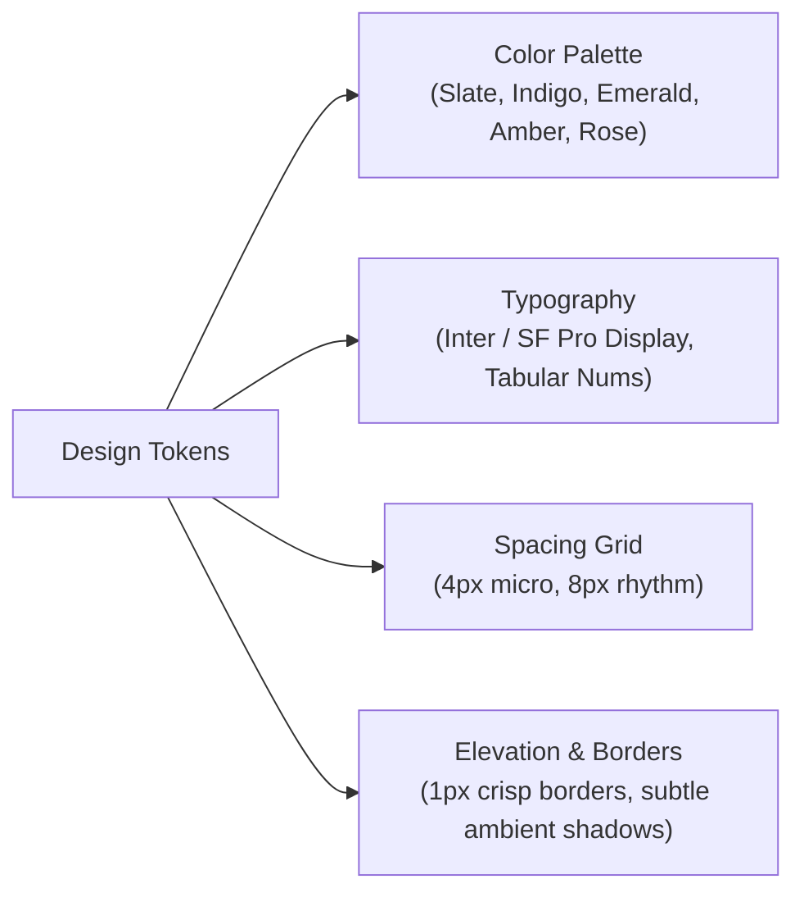
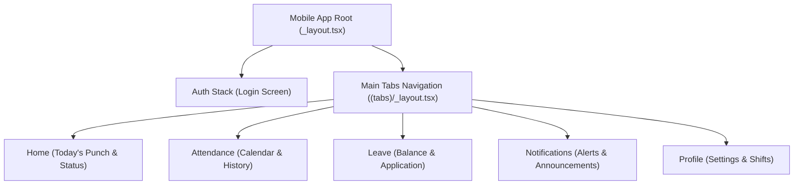

# Enterprise HR Management Platform — UI/UX Design Specification

**Document Version:** 1.0.0-PROD  
**Design Reference:** [Design Tokens & Theme Guide](file:///Users/a2adib/workStation/HRMApp/docs/design-system/DESIGN_SPECIFICATION.md)  
**Status:** Approved for Implementation (Phase 1 Baseline)  

---

## 1. Design Philosophy & Ergonomics

The Enterprise HR Management Platform balances high information density with exceptional visual clarity. It is designed to mirror the ergonomic standards of high-end productivity SaaS systems (Linear, Stripe, Notion).

### 1.1 Core Principles
* **High Contrast, Low Glare:** Neutral backgrounds (`#FFFFFF` in light mode, `#0B0F19` in dark mode) paired with surgical Indigo accents (`#4F46E5`).
* **Dual-Channel Status Indicators:** Color is never the sole communicator. Every status badge integrates a distinct background tint, a 1px border, an SVG micro-icon, and a legible label (e.g. Green dot + "Present", Amber clock + "Late (15m)").
* **Tabular Typography:** All numbers, employee codes, timestamps, and durations utilize monospace numbers (`font-variant-numeric: tabular-nums`) to prevent layout shift during live data streaming.
* **Platform Authenticity:**
  - **Web Admin:** Desktop-optimized data grids, keyboard shortcuts (`⌘K` Command Palette, `/` Search, `Esc` dismiss), collapsible sidebar, and contextual side-drawers.
  - **Mobile App:** Touch-first thumb zone ergonomics, native bottom navigation, swipe-to-dismiss sheets, haptic feedback on punch actions, and safe-area compliance.

---

## 2. Global Design Tokens

### 2.1 Color Palette
* **Primary Brand:** `indigo-600` (`#4F46E5`) with light hover `indigo-700` (`#4338CA`) and surface `indigo-50` (`#EEF2FF`).
* **Neutral Backgrounds:**
  - Light Mode: App background `slate-50` (`#F8FAFC`), Card surface `white` (`#FFFFFF`), Border `slate-200` (`#E2E8F0`).
  - Dark Mode: App background `slate-950` (`#020617`), Card surface `slate-900` (`#0F172A`), Border `slate-800` (`#1E293B`).
* **Semantic Status Matrix:**
  - `Present`: `emerald-600` / `emerald-50` (Bg) / `emerald-200` (Border)
  - `Late`: `amber-600` / `amber-50` (Bg) / `amber-200` (Border)
  - `Absent`: `rose-600` / `rose-50` (Bg) / `rose-200` (Border)
  - `On Leave`: `blue-600` / `blue-50` (Bg) / `blue-200` (Border)
  - `Holiday / Weekend`: `slate-600` / `slate-100` (Bg) / `slate-200` (Border)

---

## 3. Web Admin Dashboard Layout & Screens

### 3.1 Global Application Shell
* **Collapsible Sidebar:**
  - Top: Organization logo and tenant selector.
  - Main Navigation Items:
    1. `Dashboard` (Icon: LayoutDashboard)
    2. `Employees` (Icon: Users)
    3. `Attendance` (Icon: Clock)
    4. `Leave Management` (Icon: CalendarRange)
    5. `Shifts & Schedules` (Icon: CalendarClock)
    6. `Departments & Org` (Icon: Building2)
    7. `Reports & Analytics` (Icon: BarChart3)
    8. `Wi-Fi Ingestion` (Icon: Wifi)
    9. `Audit Logs` (Icon: ShieldCheck)
    10. `Settings` (Icon: Settings)
  - Bottom: Current user profile avatar, role badge, and theme toggle (Light / Dark).
* **Top Navigation Bar:**
  - Breadcrumb navigation (`Home / Attendance / Daily Overview`).
  - Global Search trigger (`⌘K` Command Palette).
  - Live Wi-Fi Ingestion Status Pill (Green pulsing indicator: "Wi-Fi Gateway Active").
  - Notification popover with unread counter badge.
  - User quick-menu (Account settings, Switch organization, Sign out).

### 3.2 Key Web Screens & Functional Specifications

1. **Login Screen:** Clean centered card, company logo, email/password inputs with validation, "Remember this device", forgot password link.
2. **HR Dashboard:**
   - 4-card metric strip: Total Employees, Today's Attendance Rate (%), On Leave Today, Pending Adjustments.
   - Attendance Trend chart (Recharts dual-line: Scheduled vs Actual presence).
   - Department breakdown bar chart (Attendance rate by department).
   - Quick action drawer: Pending leave requests requiring urgent sign-off.
3. **Employee Directory:**
   - Filterable data table: Search by name/email/code, multi-select department filter, status chips (`Active`, `Probation`, `Terminated`).
   - Actions: Export CSV, Add New Employee, Quick edit row.
4. **Create / Edit Employee Drawer:**
   - Tabbed or multi-section form (React Hook Form + Zod): Personal Details, Employment & Department, Shift Assignment, Wi-Fi Network Username (`RADIUS User-Name`).
5. **Employee Profile View:**
   - Header with avatar, badge code, department, contact info.
   - Sub-tabs: Profile Overview, Attendance History, Leave Balances, Assigned Shifts, Audit History.
6. **Attendance Overview:**
   - Date picker toolbar (Today, Yesterday, Custom date range).
   - Real-time presence roster with time-in, time-out, duration, and source badge (`WIFI`, `MANUAL`, `ADMIN`).
7. **Attendance Corrections (Adjustments):**
   - Approval queue for employee-submitted attendance adjustment tickets. Side-by-side comparison of original vs requested punch times and justification notes.
8. **Leave Management & Approvals:**
   - Calendar Gantt view of overlapping department leaves to prevent under-staffing.
   - Approve / Reject action buttons with required review notes modal.
9. **Shifts & Schedules:**
   - Shift card grid displaying start/end times, grace periods, break intervals, and count of assigned employees.
10. **Departments & Designations:**
    - Tree view of organizational hierarchy with department head avatars.
11. **Wi-Fi Attendance Settings:**
    - Table of registered Access Points (Name, Office, MAC address, IP, Last heartbeat).
    - Session ingestion log monitor showing real-time event counts and batch status.
12. **Reports & Exports:**
    - Custom date range generator for Payroll Summary, Monthly Attendance Timesheets, and Leave Utilization Reports.
13. **Audit Log Explorer:**
    - Searchable administrative ledger with JSON before/after state diff inspector modal.

---

## 4. Mobile Employee Application Layout & Navigation

The mobile application is built natively for iOS and Android using **Expo Router** with strict touch ergonomics:

### 4.1 Mobile Screens & Touch Interaction Patterns

1. **Splash & Biometric Authentication:**
   - Instant authentication check via Expo LocalAuthentication (FaceID / Fingerprint) or JWT refresh fallback.
2. **Home Dashboard Screen:**
   - Greeting header with employee name, avatar, and assigned office.
   - **Hero Punch Card:**
     - Dynamic status badge (`Present`, `Not Checked In`, `On Leave`).
     - Large tabular timer showing active hours worked today.
     - Primary Punch Button: Instant haptic-enabled Check-In / Check-Out trigger with location verification.
     - Secondary status: Wi-Fi Passive Tracking indicator ("Connected to Office Wi-Fi • Automatic tracking active").
   - Quick Metrics: Remaining annual leave days, shift timing (`09:00 AM - 06:00 PM`).
   - Recent activity list: Last 3 punches with timestamp and source.
3. **Attendance Screen:**
   - Interactive monthly calendar with colored status dots for each day.
   - Selected day breakdown: First check-in, last check-out, break duration, net work minutes, punctuality status (`On Time` vs `Late by 14m`).
   - Quick action: "Request Correction" opens modal to submit an adjustment ticket.
4. **Leave Application Screen:**
   - Balance cards: Annual, Sick, Casual leave remaining.
   - Application Form: Leave type selector picker, Start date / End date pickers with weekend skipping, Reason text area, Attachment uploader.
   - History list: Past leave applications with status badges (`Pending`, `Approved`, `Rejected`).
5. **Notifications Screen:**
   - Grouped list of recent alerts: Leave approval decisions, shift changes, company announcements.
6. **Profile & Settings Screen:**
   - Personal information card, assigned department, manager details.
   - Network identity verification (`Wi-Fi Username: arivera`).
   - Dark mode toggle, biometric login preference, and Secure Sign Out.

---

## 5. Accessibility (WCAG 2.1 AA) & Responsive Standards

* **Minimum Tap Target:** Mobile elements have minimum 44×44 pt touch targets.
* **Color Contrast:** All body text meets minimum contrast ratio of 4.5:1 against surfaces (7:1 for headings).
* **Keyboard Navigation:** Full web data tables and modals support `Tab`, `Shift+Tab`, `Enter`, and `Escape`.
* **Screen Reader Semantics:** Semantic HTML5 on web (`<nav>`, `<main>`, `<header>`, `aria-live` for status changes) and native accessibility labels (`accessibilityLabel`, `accessibilityRole`) on React Native components.
