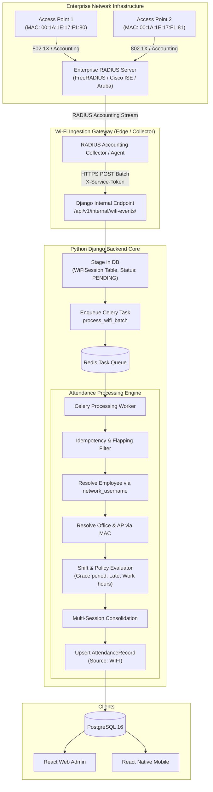
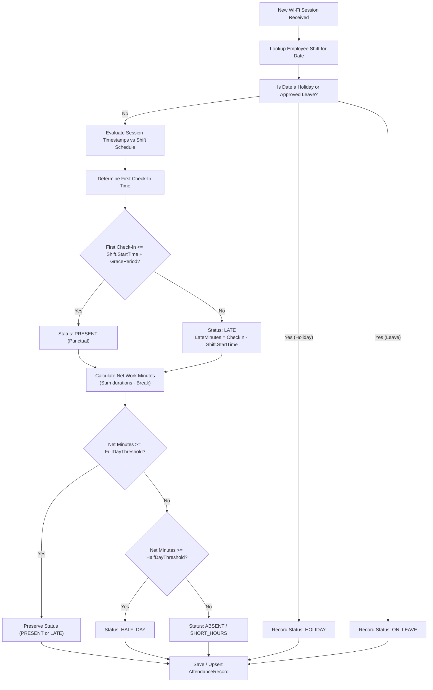

# Wi-Fi Attendance Integration Specification & Technical Analysis

**Document Version:** 1.0.0-PROD  
**Target Backend:** Python 3.12 / Django 5 / Celery / PostgreSQL  
**Reference Repository Inspected:** `https://github.com/Omar-El-Hawary/Wifi_based_attendance_tracking.git`  
**Status:** Approved for Implementation (Phase 1 Baseline)  

---

## 1. Deep Analysis of the Reference Repository

The reference repository (`Omar-El-Hawary/Wifi_based_attendance_tracking`) was cloned and inspected directly. Below is the structural and technical teardown of the original implementation.

### 1.1 Architecture & Stack
* **Language & Runtime:** Node.js (ES Modules, Express.js).
* **Database:** MySQL (via `mysql2/promise` connection pool).
* **Domain Model:** University academic setting (Students, Groups, Classes, Access Points, Wifi Sessions, Attendance).
* **External Integration:** RADIUS accounting dictionary fields (`Called-Station-Id`, `User-Name`, `Acct-Session-Time`).

### 1.2 Original Database Schema Analysis
```sql
CREATE TABLE `Groups`(
    id INT NOT NULL AUTO_INCREMENT PRIMARY KEY,
    group_name VARCHAR(255) NOT NULL,
    educational_year ENUM('1','2','3','4','5') NOT NULL
);
CREATE TABLE `Access_points`(
    id VARCHAR(255) NOT NULL PRIMARY KEY, -- MAC address or identifier
    nas_name VARCHAR(255) NOT NULL,
    location_name VARCHAR(255) NOT NULL
);
CREATE TABLE `Classes`(
    id INT NOT NULL AUTO_INCREMENT PRIMARY KEY,
    name VARCHAR(255) NOT NULL,
    period ENUM('first','second','third','fourth'),
    type ENUM('section','lecture') NOT NULL,   
    day ENUM('sunday','monday','tuesday','wednesday','thursday','saturday'),
    end_time DATETIME NOT NULL,
    access_point_id VARCHAR(255) NOT NULL,
    duration INT NOT NULL,
    group_id INT NOT NULL
);
CREATE TABLE `Students`(
    id INT NOT NULL AUTO_INCREMENT PRIMARY KEY,
    faculty INT NOT NULL, 
    name VARCHAR(255) NOT NULL,
    group_id INT NOT NULL,
    class_id INT
);
CREATE TABLE `Wifi_sessions`(
    id INT NOT NULL AUTO_INCREMENT PRIMARY KEY,
    entry_time DATETIME NOT NULL DEFAULT CURRENT_TIMESTAMP,
    student_id INT NOT NULL,
    duration INT NOT NULL,
    access_point_id VARCHAR(255) NOT NULL
);
CREATE TABLE `Attendance`(
    id INT NOT NULL AUTO_INCREMENT PRIMARY KEY,
    class_id INT NOT NULL,
    student_id INT NOT NULL,
    group_id INT NOT NULL,
    attended BOOLEAN NOT NULL,
    percentage INT NOT NULL,
    entry_date DATE DEFAULT(NOW())
);
```

### 1.3 Identification of Critical Bugs & Limitations in Reference Code

1. **Syntax & Runtime Bug in Field Extraction:**
   In `server.js`:
   ```javascript
   const apMacAdd = req.body.Called-Station-Id;
   const studentId = req.body.User-Name;
   const sessionDuration = req.body.Acct-Session-Time;
   ```
   In JavaScript, hyphenated object access without square brackets evaluates as arithmetic subtraction (`req.body.Called - Station - Id`), throwing a runtime `ReferenceError: Station is not defined` or returning `NaN`.
2. **Volatile In-Memory Batching:**
   The reference code buffers raw events in an in-memory array (`cachedLoggedRows`) and only writes to MySQL once the buffer reaches 50 entries. If the server crashes or restarts, or if traffic is light, unwritten sessions are permanently lost.
3. **Array Comparison Logic Flaw:**
   In `checkAttendance()`:
   ```javascript
   if (insertRows == []) {
       await pool.query(`INSERT INTO Attendance ...`, newRows);
   }
   ```
   In JavaScript, `[] == []` is always `false` due to object reference inequality, and `newRows` is an undefined variable in that scope.
4. **Lack of Enterprise HR Context:**
   - Designed exclusively for lecture slots (e.g. 40% threshold of a 100-minute lecture).
   - Lacks employee shifts, flexible working hours, lunch breaks, late grace periods, overtime, timezones, multi-tenancy, or leave integration.
5. **Absence of Idempotency & Session Lifecycle:**
   - Only processes session end packets (`sessionEnd`); cannot reconcile ongoing sessions, duplicate RADIUS accounting retries, or interim updates.

---

## 2. Enterprise Adaptation Architecture

To transform these concepts into an enterprise-grade system, the Wi-Fi tracking engine is decoupled into a dedicated event-driven ingestion and processing pipeline.



---

## 3. Core Requirements & Integration Logic

### 3.1 Employee Identity Mapping
* Enterprise employees connect to 802.1X Wi-Fi using their enterprise credentials (LDAP / Active Directory / Google Workspace SSO).
* The RADIUS server outputs the authenticated username in the `User-Name` attribute (e.g. `arivera` or `arivera@acme-corp.com`).
* The backend resolves this username against `Employee.network_username` within the specific `organization_id`.
* If no matching employee is found, the session is preserved with `status='IGNORED'` and `error_message='Unknown network username'` for audit review.

### 3.2 Access Point & Office Mapping
* Access Point BSSID/MAC is extracted from the RADIUS `Called-Station-Id` attribute.
* MAC addresses are sanitized to standard upper-case colon-separated format (`AA:BB:CC:DD:EE:FF`).
* The system looks up `AccessPoint` by `organization_id` and `mac_address`.
* Access points are tied to specific `Office` facilities, automatically attributing the employee's physical presence to that office.

### 3.3 Session De-duplication & Flapping Suppression
* **Network Flapping Problem:** Laptops and smartphones occasionally disconnect when roaming between access points or entering power-saving sleep for 1–3 minutes. Treating each reconnect as a separate check-in/check-out causes session fragmentation.
* **Flapping Suppression Algorithm:**
  - If a new session starts within `FLAPPING_THRESHOLD_MINUTES` (configurable, default: 5 minutes) of the previous session end for the same employee, the sessions are logically merged into a continuous active presence block.
  - Duplicate RADIUS accounting packets (same username, MAC, start time) are rejected via unique constraint checks on session signatures.

### 3.4 Shift-Aware Attendance Calculation Rules



#### Calculation Attributes:
1. **First Check-In:** The earliest `session_start` recorded at an authorized office AP on the attendance date.
2. **Last Check-Out:** The latest `session_end` recorded at an authorized office AP on the attendance date.
3. **Late Arrival:** If `first_check_in > (shift.start_time + shift.grace_period_minutes)`, calculate:
   $$\text{late\_minutes} = \max(0, \lfloor (\text{first\_check\_in} - \text{shift.start\_time}) / 60 \rfloor)$$
4. **Early Departure:** If `last_check_out < shift.end_time`, calculate:
   $$\text{early\_departure\_minutes} = \max(0, \lfloor (\text{shift.end\_time} - \text{last\_check\_out}) / 60 \rfloor)$$
5. **Net Work Minutes:**
   $$\text{total\_work\_minutes} = \max(0, \sum(\text{session\_duration}) - \text{shift.break\_duration\_minutes})$$
6. **Missing Check-Out Handling:**
   - If an employee has a `session_start` but no `session_end` by the end of the shift cycle (e.g. device disconnected without RADIUS stop packet), Celery Beat runs a reconciliation job at midnight that caps the session duration at shift end and marks `notes='Auto-closed missing check-out'`.

### 3.5 Attendance Sources & Hierarchy
Attendance records maintain strict source provenance:
1. `ADMIN_CORRECTION` (Highest priority): Manual overrides by HR Administrator lock the record (`is_finalized=True`), preventing automatic recalculation.
2. `MANUAL`: Mobile application check-ins with GPS coordinates take precedence over unverified Wi-Fi events.
3. `WIFI`: Passive network session consolidation.

### 3.6 Mobile Safety & Security Boundaries
* **No Background Mobile Scanning:** Neither iOS nor Android client apps perform continuous background Wi-Fi SSID/BSSID scanning, preventing excessive battery drain and privacy permission violations (Apple App Store / Google Play background location restrictions).
* **Credential Isolation:** RADIUS credentials, 802.1X secrets, and network infrastructure keys are never transmitted to or stored on mobile devices.
* **Internal API Authentication:** The `/api/v1/internal/wifi-events/` endpoint is protected by a cryptographically random HMAC secret token (`X-Service-Token`) and network-restricted to the internal collector IP address.

---

## 4. Ingestion API Payload & Mock Event Feeder

For development, testing, and continuous integration, the platform includes a synthetic RADIUS event feeder (`scripts/mock_wifi_feeder.py`) that simulates enterprise network traffic:

```json
{
  "organization_id": "780d6b63-d1f8-4e89-a9a5-c7255f058091",
  "batch_id": "sim-20261115-0900",
  "events": [
    {
      "called_station_id": "00:1A:1E:17:F1:80",
      "user_name": "arivera",
      "calling_station_id": "F4:D4:88:51:2A:9C",
      "nas_ip_address": "10.0.1.1",
      "session_start": "2026-11-15T08:55:00Z",
      "session_end": "2026-11-15T12:30:00Z",
      "session_duration_seconds": 12900
    }
  ]
}
```
This guarantees robust end-to-end verification without requiring a live physical RADIUS server during local development.
